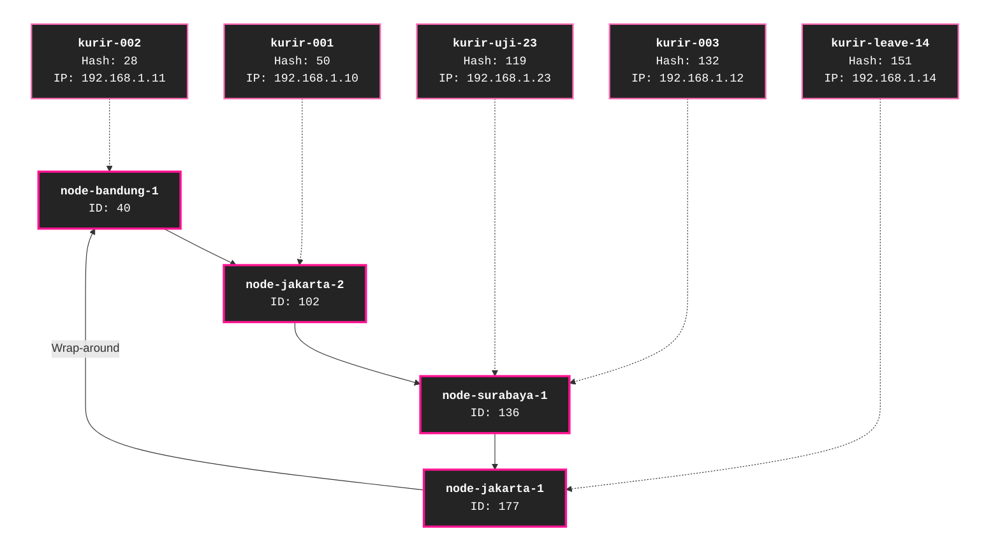

# Tugas 6 (Pekan 6) — Penamaan & Resolusi Lokasi

**Materi terkait:** Flat Naming, Structured Naming (DNS), Distributed Hash Table (DHT)/Chord.

## Studi Kasus

Pelanggan FoodGo kesulitan menemukan alamat IP server kurir yang **dinamis** (kurir berpindah lokasi/jaringan, IP-nya sering berubah). FoodGo butuh cara memetakan **ID Kurir** (identitas tetap) ke **alamat IP terkininya** tanpa server pusat tunggal yang jadi bottleneck/single point of failure.

## Tugas Kelompok

Implementasikan **simulasi Chord DHT** sederhana (single-process, tidak perlu jaringan sungguhan — cukup simulasi struktur data & algoritma di satu program Python) yang memetakan ID Kurir ke alamat IP mereka.

Konsep yang harus terlihat jalan dalam simulasi kalian:
1. **Consistent hashing**: ID Kurir dan ID Node di-hash ke ruang angka yang sama (mis. 0–255 untuk kesederhanaan, `m=8` bit).
2. **Ring topology**: node-node diurutkan melingkar berdasarkan hasil hash-nya.
3. **Lookup**: fungsi `lookup(kurir_id)` yang menemukan node mana yang bertanggung jawab menyimpan mapping ID Kurir tersebut → alamat IP-nya (aturan Chord: node dengan ID hash **terkecil yang lebih besar atau sama dengan** hash key, disebut *successor*).
4. **Perubahan topologi**: simulasikan minimal satu node baru bergabung (`join`) atau satu node keluar (`leave`), tunjukkan bagaimana mapping berpindah tanggung jawab ke node lain.

Skeleton disediakan di `src/chord_simulation.py` dengan fungsi hashing dan struktur ring sudah ada — bagian `lookup()`, `join()`, dan `leave()` sengaja dikosongkan.

### Cara Menjalankan

```bash
python3 src/chord_simulation.py
```

## Tugas Analisis (`README.md`)

1. Jelaskan **kenapa DHT/Chord** lebih cocok untuk kasus ini dibanding **flat naming sederhana** (mis. tabel pusat ID→IP) atau **DNS konvensional** — kaitkan dengan sifat "IP kurir sering berubah" dan kebutuhan tanpa titik gagal tunggal.
2. Gambarkan (boleh pakai Mermaid, lihat Tugas 2) ring topology dari simulasi kalian, tandai node mana yang bertanggung jawab atas ID Kurir mana.
3. Jelaskan apa yang terjadi pada mapping saat sebuah node **keluar** dari ring (siapa yang mengambil alih tanggung jawabnya) — dukung dengan output program.

## Jawaban

### 1. Analisis DHT/Chord Dibandingkan Flat Naming dan DNS Konvensional (Arynal Haq Syafi'i)

FoodGo membutuhkan mekanisme pemetaan ID Kurir yang bersifat tetap ke alamat IP yang dapat berubah karena kurir dapat berpindah lokasi atau jaringan. Oleh karena itu, diperlukan sistem penamaan yang mampu menangani perubahan alamat IP tanpa bergantung pada satu server pusat.

#### Perbandingan dengan Flat Naming

Pada pendekatan flat naming sederhana, pemetaan ID Kurir ke alamat IP dapat disimpan dalam sebuah tabel pusat. Pendekatan ini mudah diterapkan, tetapi seluruh proses pencarian dan pembaruan alamat IP bergantung pada satu komponen. Jika server pusat mengalami gangguan, proses pencarian alamat IP kurir dapat terhambat. Selain itu, meningkatnya jumlah kurir dapat menambah beban pada server tersebut sehingga berpotensi menjadi *bottleneck*.

Sebaliknya, Chord DHT menggunakan *consistent hashing* untuk memetakan ID Kurir dan ID node ke ruang identitas yang sama. Setiap mapping menjadi tanggung jawab node *successor* yang ditentukan berdasarkan aturan Chord. Dengan pembagian tanggung jawab tersebut, penyimpanan dan pencarian mapping tidak harus bergantung pada satu tabel pusat.

#### Perbandingan dengan DNS Konvensional

DNS konvensional juga menggunakan sistem terdistribusi untuk menerjemahkan nama domain menjadi alamat IP. Namun, perubahan alamat IP membutuhkan pembaruan record DNS dan dapat dipengaruhi oleh mekanisme *caching* serta TTL. Akibatnya, pengguna masih mungkin memperoleh alamat IP lama selama informasi sebelumnya masih tersimpan dalam cache.

Pada simulasi FoodGo, Chord memperlihatkan secara langsung bagaimana ID Kurir yang bersifat tetap digunakan untuk menemukan node yang bertanggung jawab atas mapping alamat IP-nya. Ketika terjadi perubahan topologi, seperti node bergabung atau keluar, tanggung jawab mapping dapat berpindah ke node *successor* yang sesuai dengan aturan ring.

#### Kesimpulan

Berdasarkan perbandingan tersebut, Chord DHT merupakan pendekatan yang relevan untuk kasus FoodGo karena mampu membagi tanggung jawab penyimpanan mapping ID Kurir ke beberapa node tanpa memerlukan satu server pusat sebagai tempat seluruh mapping disimpan.

Mekanisme *successor* juga memungkinkan pencarian mapping berdasarkan ID Kurir tetap meskipun alamat IP dan susunan node mengalami perubahan.

## 2. Analisis dan Visualisasi Ring Chord DHT (Arynal Haq Syafi'i)

Bagian ini menjelaskan struktur ring Chord DHT serta pemetaan Courier ke node yang bertanggung jawab. Visualisasi dilakukan untuk melihat perubahan pemetaan ketika terjadi proses *join* dan *leave* node.

### 2.1 Kondisi Awal Ring Chord

Pada kondisi awal, terdapat empat node dalam ring Chord, yaitu ID 40, 102, 136, dan 177. Setiap Courier dipetakan ke node *successor* berdasarkan Hash ID masing-masing.

**Gambar 2.1 Kondisi Awal Ring Chord**



Berdasarkan diagram, `node-surabaya-1` bertanggung jawab atas dua Courier, yaitu `kurir-uji-23` dan `kurir-003`. Sementara itu, setiap Courier lainnya dipetakan ke node *successor* masing-masing.

## Struktur Submission

```
tugas-06-penamaan-dht/
├── README.md      # Analisis + diagram ring
├── JURNAL.md
├── src/
│   └── chord_simulation.py
└── bukti/          # Output program (screenshot/log) untuk skenario join & leave
```

## Rubrik Penilaian (Tugas 6)

| Komponen | Bobot | Kriteria |
|---|---|---|
| Implementasi lookup/join/leave benar | 35% | Consistent hashing & successor lookup sesuai aturan Chord |
| Bukti perubahan topologi (join/leave) | 25% | Output menunjukkan mapping berpindah dengan benar |
| Analisis kenapa DHT vs flat naming/DNS | 25% | Argumen spesifik ke kasus IP kurir dinamis, bukan definisi umum |
| Proses & kontribusi kelompok | 15% | `JURNAL.md`, commit history |

## Batasan Penggunaan AI (Level 2)

Kebijakan **Level 2 (AI Assisted Idea Generation & Structuring)** berlaku — lihat [`../RUBRIK-UMUM.md`](../RUBRIK-UMUM.md). Boleh bertanya konsep umum consistent hashing/Chord ke AI; **tidak boleh** meminta AI menuliskan isi `# TODO` di `src/chord_simulation.py` (`find_successor`, `join`, `leave`, dst). Catat pemakaian AI di "Log Penggunaan AI" pada `JURNAL.md`.

- `README.md` wajib menelusuri manual (langkah demi langkah) bagaimana `lookup()` menemukan successor untuk salah satu ID Kurir contoh yang dipakai di `chord_simulation.py` — bukan cuma menempelkan output program.
