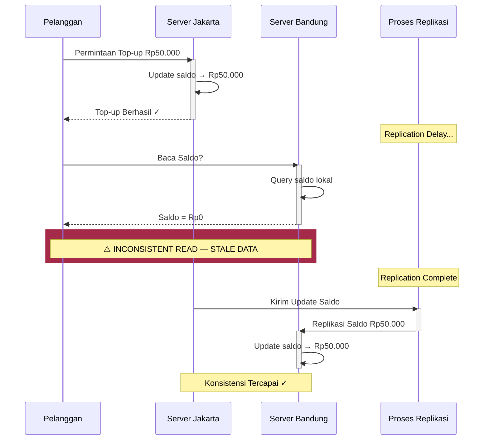
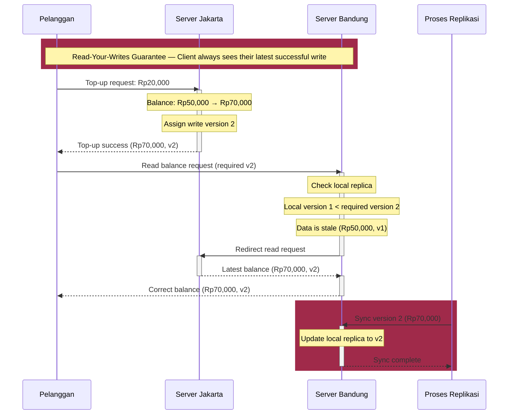

# Tugas 7 (Pekan 7) — Konsistensi Data

**Materi terkait:** Data-Centric Consistency (Sequential, Eventual), Client-Centric Consistency.

## Studi Kasus


## Tugas Kelompok

### Bagian 1 — Analisis (wajib)

1. Tentukan: apakah kasus ini **membutuhkan Sequential Consistency** (semua replika melihat urutan operasi yang sama) atau **cukup Eventual Consistency** (replika akan konsisten "pada akhirnya", boleh sementara berbeda)? Berikan argumen berbasis dampak bisnis (mis. kasus saldo *e-wallet* jauh lebih sensitif dibanding kasus "jumlah like" di media sosial).
2. Jika kalian menyimpulkan Eventual Consistency saja **tidak cukup** untuk skenario ini, usulkan pendekatan **Client-Centric Consistency** yang relevan (mis. *Read-Your-Writes*: pelanggan yang baru top-up harus selalu melihat saldo terbarunya sendiri, walau replika lain belum sinkron).
3. Gambarkan **diagram alir urutan (sequence diagram)** yang menunjukkan operasi read/write antara pelanggan, server Jakarta, server Bandung, dan proses replikasi — untuk skenario **tanpa** jaminan konsistensi (bug terjadi) DAN skenario **dengan** solusi yang kalian usulkan (bug teratasi). Pakai Mermaid (`sequenceDiagram`) di `README.md` — lihat contoh cara pakai di Tugas 2.

### Bagian 2 — Simulasi (opsional, nilai tambah)

Skeleton `src/replica_simulation.py` mensimulasikan dua replika (Jakarta & Bandung) dengan delay replikasi buatan. Lengkapi TODO untuk:
1. Menunjukkan kondisi **inconsistent read** (replika Bandung masih menunjukkan saldo lama walau Jakarta sudah update).
2. Mengimplementasikan mekanisme **Read-Your-Writes** sederhana (mis. dengan version/timestamp per client) yang memperbaiki masalah tersebut.

```bash
python3 src/replica_simulation.py
```

## Jawaban

### 1.1 Pemilihan Model Konsistensi

Pada studi kasus FoodGo, Eventual Consistency saja tidak cukup untuk menjamin keakuratan pembacaan saldo e-wallet pelanggan. Hal ini karena saldo berkaitan langsung dengan transaksi keuangan, sehingga keterlambatan replikasi antarserver dapat menyebabkan kesalahan dalam proses transaksi.

Sebagai contoh, ketika pelanggan melakukan top-up sebesar Rp50.000 melalui server Jakarta, saldo pelanggan langsung diperbarui di server tersebut. Namun, ketika pelanggan melakukan pemesanan melalui server Bandung sebelum proses replikasi selesai, server Bandung masih membaca saldo lama sebesar Rp0. Akibatnya, transaksi dapat ditolak meskipun pelanggan sebenarnya sudah memiliki saldo yang cukup.

Dalam kondisi ini, sistem membutuhkan jaminan konsistensi yang lebih kuat daripada Eventual Consistency saja. Sequential Consistency dapat menjadi pendekatan untuk menjaga agar seluruh replika mengamati urutan operasi yang konsisten. Namun, penerapan konsistensi global seperti ini tidak selalu diperlukan untuk memenuhi kebutuhan setiap pelanggan.

Oleh karena itu, pendekatan yang digunakan adalah mempertahankan replikasi antarserver dengan Eventual Consistency, kemudian menambahkan jaminan Client-Centric Consistency berupa Read-Your-Writes. Pendekatan ini memastikan pelanggan dapat melihat hasil top-up yang telah dilakukannya sendiri tanpa harus menunggu seluruh replika selesai diperbarui.

Pemilihan pendekatan ini didasarkan pada dampak bisnis. Kesalahan pembacaan jumlah like pada media sosial umumnya tidak langsung menyebabkan kerugian finansial, sedangkan kesalahan pembacaan saldo e-wallet dapat menghambat transaksi dan menurunkan kepercayaan pelanggan terhadap FoodGo.

### 1.2 Usulan Solusi Client-Centric Consistency

Solusi yang diusulkan adalah menggunakan mekanisme Read-Your-Writes. Mekanisme ini memastikan bahwa pelanggan selalu dapat membaca hasil perubahan data yang sebelumnya telah dilakukan, meskipun replika lain belum menerima pembaruan tersebut.

Implementasi solusi dilakukan melalui tahapan berikut:

1. Pelanggan melakukan top-up melalui server Jakarta.
2. Server Jakarta memperbarui saldo pelanggan dan memberikan nomor versi terbaru.
3. Pelanggan menyimpan informasi versi terakhir dari operasi top-up tersebut.
4. Ketika pelanggan membaca saldo melalui server Bandung, sistem memeriksa versi data yang tersedia.
5. Jika versi server Bandung lebih rendah daripada versi minimal yang dibutuhkan pelanggan, sistem mengarahkan pembacaan ke server Jakarta.
6. Server Jakarta mengembalikan saldo dengan versi terbaru kepada pelanggan.
7. Proses replikasi tetap berjalan agar server Bandung pada akhirnya memiliki data yang sama.

Dengan mekanisme tersebut, pelanggan dapat melihat saldo terbarunya tanpa harus menunggu proses replikasi antarserver selesai.

### 1.3 Sequence Diagram

**Diagram 1. Inconsistent Read (Without Consistency Guarantee)**

Diagram berikut menggambarkan kondisi ketika proses replikasi data mengalami keterlambatan. Pelanggan berhasil melakukan top-up melalui Server Jakarta, tetapi ketika membaca saldo melalui Server Bandung, data yang ditampilkan masih menggunakan saldo lama.



**Diagram 2. Consistent Read (With Read-Your-Writes Guarantee)**

Diagram berikut menggambarkan penerapan mekanisme *Read-Your-Writes* untuk mengatasi permasalahan pembacaan data yang tidak konsisten. Sistem memeriksa versi data pada Server Bandung. Jika versi lokal lebih lama daripada versi yang dibutuhkan pelanggan, permintaan pembacaan saldo akan dialihkan ke Server Jakarta agar pelanggan memperoleh saldo terbaru.



## Struktur Submission

```
tugas-07-konsistensi-data/
├── README.md      # Analisis konsistensi + sequence diagram Mermaid
├── JURNAL.md
├── src/            # (opsional) simulasi replikasi
└── bukti/          # (jika mengerjakan simulasi) output program
```

## Rubrik Penilaian (Tugas 7)

| Komponen | Bobot | Kriteria |
|---|---|---|
| Ketepatan pemilihan model konsistensi | 30% | Argumen berbasis dampak bisnis nyata, bukan hafalan definisi |
| Kualitas sequence diagram | 30% | Menunjukkan jelas titik kegagalan & titik perbaikan |
| Usulan solusi client-centric | 25% | Solusi konkret dan dapat diimplementasikan (bukan wacana abstrak) |
| Proses & kontribusi kelompok | 15% | `JURNAL.md`, commit history (+ bonus jika simulasi dikerjakan) |

## Batasan Penggunaan AI (Level 2)

Kebijakan **Level 2 (AI Assisted Idea Generation & Structuring)** berlaku — lihat [`../RUBRIK-UMUM.md`](../RUBRIK-UMUM.md). Boleh bertanya konsep umum consistency model ke AI untuk brainstorming; **tidak boleh** meminta AI menuliskan analisis akhir/sequence diagram atau isi `# TODO` di `src/replica_simulation.py` yang tinggal ditempel. Catat pemakaian AI di "Log Penggunaan AI" pada `JURNAL.md`.

- Sebagai bukti pemahaman konsep (bukan hafalan jawaban skenario FoodGo saja), `README.md` wajib menyertakan **satu skenario tambahan** yang kalian buat sendiri (mis. kasus lain di aplikasi ojek online) dan menentukan model konsistensi yang tepat untuk skenario tambahan tersebut.
